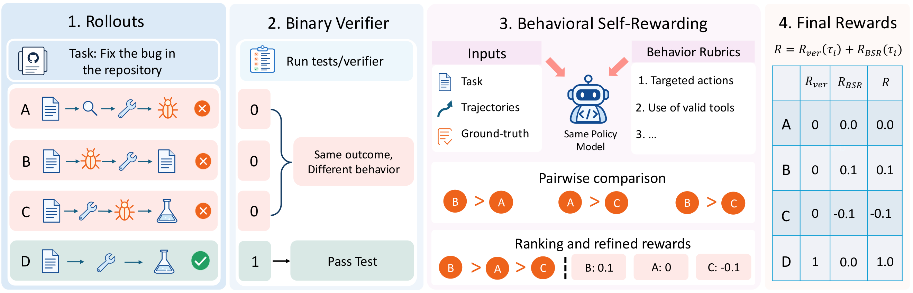
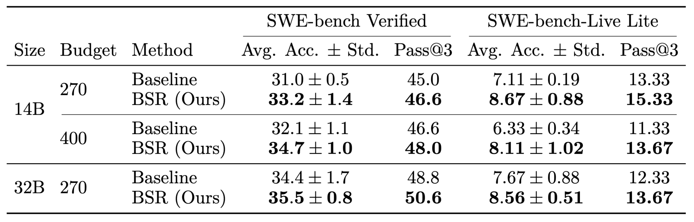

<div align="center">

# Beyond Binary Verifiable Rewards: Behavioral Self-Rewarding for SWE Agents

**Learning from debugging behavior while keeping executable tests as the source of correctness.**

Yiran Wu · Andrew Zhao · Yurui Chang · Qingyun Wu · Xuan Feng

[](https://github.com/yiranwu0/behavioral-self-rewarding)
[](https://arxiv.org/pdf/2610.12598v1)
[](https://yiranwu0.github.io/projects/bsr/)
[](https://wandb.ai/kevinwy00-penn-state/behavioral-self-rewarding)
[](https://huggingface.co/wyrkevin/BSR-14B)

[🎉 News](#news) · [⚙️ Algorithm Flow](#algorithm-flow) · [📊 Results](#results)

[✨ Getting Started](#getting-started) · [🏋️ Training](#training) · [🔧 Code Structure](#code-structure) · [📃 Evaluation](#evaluation)

[🎈 Citation](#citation) · [🌻 Acknowledgements](#acknowledgements) · [📧 Contact](#contact)

</div>

**Behavioral Self-Rewarding (BSR)** is a reward-refinement method for training software engineering agents with reinforcement learning. Binary tests tell us whether a patch works, but failed attempts can differ greatly in debugging quality. BSR reuses the current policy to compare observable debugging behavior among trajectories from the same task with the same verifier outcome, then turns those judgments into centered, bounded auxiliary rewards. This adds supervision from already-collected trajectories while preserving the verifier's pass/fail ordering, without a separately trained reward model or new environment interactions.

This is the **Behavioral Self-Rewarding (BSR)** code release by **Yiran Wu, Andrew Zhao, Yurui Chang, Qingyun Wu, and Xuan Feng**. The Python distribution is named `behavioral-self-rewarding`; the inherited `rllm` import namespace is retained for compatibility. Our training stack builds on rLLM, R2E-Gym, and the DeepSWE recipe; see [Acknowledgements](#acknowledgements) and [third-party notices](licenses/THIRD_PARTY_NOTICES.md).

> **Status:** Research code. Training requires a GPU Ray cluster and a separate CPU Kubernetes cluster.

<a id="news"></a>

## 🎉 News

- We introduce **Behavioral Self-Rewarding**, which improves average accuracy and Pass@3 over verifier-only RL on **SWE-bench Verified** and **SWE-bench-Live Lite** across the evaluated Qwen3-14B and Qwen3-32B configurations. See [evaluation results](#results).

<a id="algorithm-flow"></a>

## ⚙️ Algorithm Flow

[](assets/figures/bsr-framework.pdf)

*BSR recovers reward contrast among trajectories with the same verifier outcome. The figure illustrates failure-only refinement; passing trajectories keep reward 1. Click the figure for the PDF.*

BSR repeats the following steps for each training batch:

1. **Act and verify.** Sample multiple trajectories for each issue and evaluate the resulting patches with executable tests.
2. **Group by outcome.** Separate passing and failing trajectories within each task.
3. **Compare behavior.** Use the current policy to judge pairs from the same outcome group. Each judgment selects a winner and a preference strength of 1, 2, or 3. Pair order is randomized; small groups use exhaustive comparisons and larger groups use a Swiss-style schedule.
4. **Refine the reward.** Fit weighted Bradley–Terry ranking scores, normalize within the group, and apply a soft deadzone. Center and bound scores outside the deadzone; trajectories inside it retain zero auxiliary reward.
5. **Update the policy.** Train with the verifier reward plus the auxiliary reward using the LOOP advantage estimator.

The judge sees compact action-observation traces, supporting trajectory statistics, the task, and its reference patch. **The reference patch is supplied only to the post-rollout judge; the acting policy has no access to it during training or evaluation.** Internal thinking is removed from the trajectory representation. The rubric emphasizes investigation, evidence gathering, task-relevant edits, and verification rather than writing style or patch similarity.

For a trajectory with verifier outcome `y`, the final reward is:

```text
R = y + a_y × q,    q ∈ [-1, 1]
```

Choosing nonnegative amplitudes with `a_0 + a_1 < 1` preserves the ordering between every passing and failing trajectory. Singleton groups receive no auxiliary reward.

**The main paper setting refines failed trajectories only**, including failures in both all-fail and mixed-outcome groups: `a_0 = 0.15`, `a_1 = 0`, with deadzone threshold and softness both `0.5`. Passing trajectories retain reward 1. Judging adds model inference during training; evaluation runs only the acting policy, without BSR judge calls.

<a id="getting-started"></a>

## ✨ Getting Started

### System layout

Training uses two connected systems:

- **GPU machines:** Ray coordinates distributed policy training and vLLM rollout generation.
- **CPU Kubernetes cluster:** R2E-Gym runs repository environments and executable verification in task pods.

GPU workers need access to the Kubernetes API, model and dataset artifacts, and checkpoint storage. Repository task images must be available to the CPU nodes.

### Hardware used in the paper

| Component | Paper configuration |
| --- | --- |
| Qwen3-14B training | 8 nodes × 8 NVIDIA A100-SXM4-40GB GPUs = **64 GPUs** |
| Qwen3-32B training | 16 nodes × 8 NVIDIA A100-SXM4-40GB GPUs = **128 GPUs** |
| Environment cluster | 2 CPU nodes, each with 128 CPU cores and approximately 500 GB RAM |
| Reported training duration | Approximately 6–8 days per run |

These are the experimental configurations; minimum hardware requirements have not been established.

### 1. Set up the GPU environment

Install a recent NVIDIA driver and CUDA toolkit, then run the setup script on every Linux GPU machine from a checkout of this repository:

```bash
bash myinstall.sh
source .venv/bin/activate
```

The script creates `.venv`, installs BSR and the bundled R2E-Gym and veRL packages, applies the included vLLM patches, and checks CUDA access. Set `BSR_VENV_DIR` before running it if you want the environment elsewhere.

See [myinstall.sh](myinstall.sh) for the supported setup and [vllm_patch/](vllm_patch/) for the runtime patches. GPU dependencies are in the package's `gpu` extra; browser environments use the optional `browser` extra, and development tools use `dev`.

#### Credentials

Create a Hugging Face access token and a Weights & Biases API key, then export them on every GPU machine. Do not put real tokens in scripts or commit them to Git.

```bash
export HF_TOKEN="<your-hugging-face-token>"
export WANDB_API_KEY="<your-wandb-api-key>"
export KUBECONFIG="/path/to/your/kubeconfig"
```

The training launchers require `HF_TOKEN` and `WANDB_API_KEY`. Kubernetes and Docker registry credentials are covered in the [Kubernetes setup](kube/README.md).

<a id="kubernetes"></a>

### 2. Set up Kubernetes

Follow the complete [Kubernetes setup guide](kube/README.md) to configure cluster access, the Docker Hub pull secret, image caching, capacity, and per-run cleanup.

The short setup path is:

```bash
export KUBECONFIG=/path/to/your/kubeconfig
bash kube/setup_kube.sh
python kube/test_kube.py "$KUBECONFIG"
```

### 3. Prepare the data

After installing the environment, run the data preparation entry point from the repository root:

```bash
python swe_scripts/prepare_swe_data.py --local_dir ./data/swe
```

It prepares the configured R2E-Gym datasets as:

```text
data/swe/R2E_Gym_Subset.parquet
data/swe/SWE_Bench_Verified.parquet
```

The paper uses **4,578 filtered R2E-Gym training tasks** and evaluates on **500 SWE-bench Verified tasks** and **300 SWE-bench-Live Lite tasks**. This preparation script covers R2E-Gym Subset and Verified. To select training images explicitly, pass `--train_image_list /path/to/images.txt` with one `docker_image` per line. Verified is always kept in full. The exact 4,578-task training manifest is not included, so the default training output is not an exact reproduction of the paper's filtered set.

<a id="training"></a>

## 🏋️ Training

### Experiment entry points

| Model | BSR | Verifier-only baseline |
| --- | --- | --- |
| Qwen3-14B | [14b_btl.sh](swe_scripts/final/14b_btl.sh) | [14b_baseline.sh](swe_scripts/final/14b_baseline.sh) |
| Qwen3-32B | [32b_btl.sh](swe_scripts/final/32b_btl.sh) | [32b_baseline.sh](swe_scripts/final/32b_baseline.sh) |

Start Ray on the head GPU machine, join each worker using the head address, and run the training command on the head:

```bash
# Head GPU machine
ray start --head --port=6379

# Each worker GPU machine
ray start --address="<head-ip>:6379"
```

Export the credentials above on the head machine, then run one launcher with a unique run name:

```bash
bash swe_scripts/final/14b_btl.sh my-bsr-run
# or
bash swe_scripts/final/32b_btl.sh my-bsr-run
```

The launchers default to 8 GPU nodes for Qwen3-14B and 16 for Qwen3-32B, with 8 GPUs per node. Set `NNODES` and `GPU_PER_NODE_COUNT` to match your deployment, and use the same checkout and environment on each Ray worker. See [swe_scripts/ablations/](swe_scripts/ablations/) for ablation launchers.

The main training recipe uses **64 tasks per batch**, **8 rollouts per task**, **40 agent steps**, temperature **1.0**, learning rate **1e-6**, and the **LOOP** advantage estimator. The BSR launchers use `refine_reward.method=rank_fail` with the failure-only reward settings above. Environment prefetching overlaps pod creation with policy updates, and each rollout starts when its own environment is ready.

The inherited launchers set `agent.overlong_filter=True`: step-limit, timeout,
and truncated trajectories are masked out, and BSR ranks completed, unmasked
trajectories only. The paper's algorithm does not describe this exclusion.
This behavior is retained from the experiment recipe and is a reproduction
limitation alongside the missing exact training manifest.

In the paper's measured Qwen3-14B configuration, BSR adds **19.86% wall-clock training time** over verifier-only RL under the same training and serving GPU allocation. It reuses the policy-serving infrastructure for judging; this overhead is incurred during training.

<a id="code-structure"></a>

## 🔧 Code Structure

| Path | Purpose |
| --- | --- |
| [myinstall.sh](myinstall.sh) | Linux GPU environment setup |
| [rllm/engine/rank_reward.py](rllm/engine/rank_reward.py) | Pairwise judge prompts, ranking aggregation, and reward mapping |
| [rllm/engine/agent_execution_engine.py](rllm/engine/agent_execution_engine.py) | Agent rollouts, trajectory grouping, comparison scheduling, and reward integration |
| [rllm/engine/trajectory_summarize_v2.py](rllm/engine/trajectory_summarize_v2.py) | Paper trajectory compaction utilities |
| [rllm/trainer/](rllm/trainer/) | BSR training integration and configuration |
| [rllm/environments/swe/](rllm/environments/swe/) | SWE environment integration and image-cache helper |
| [swe_scripts/](swe_scripts/) | Data preparation, main experiments, and ablations |
| [kube/](kube/) | Existing Kubernetes access notes and checks |
| [R2E-Gym/](R2E-Gym/) | Bundled R2E-Gym environment, agent runtime, and evaluation components |
| [verl/](verl/) | Bundled distributed RL backend |
| [vllm_patch/](vllm_patch/) | Local vLLM runtime patches |

<a id="evaluation-code"></a>
<a id="evaluation"></a>

## 📃 Evaluation

### How to evaluate

The main evaluation entry point is [R2E-Gym/eval/run_eval.sh](R2E-Gym/eval/run_eval.sh). It serves one or more checkpoints with vLLM and evaluates the full **500-task SWE-bench Verified** test split. Complete the GPU and Kubernetes setup above, start or join the Ray cluster, and export `KUBECONFIG` and `HF_TOKEN` as needed.

Place vLLM-loadable model checkpoints under `R2E-Gym/models/<folder>/` at the same path on every GPU node, or use shared storage mounted there. Directories named `global_step_<n>` are discovered automatically; model files can be directly inside each directory or its `checkpoint/` subdirectory. For example, evaluate `R2E-Gym/models/my-checkpoints/global_step_270/` with the paper's SWE evaluation settings:

```bash
source .venv/bin/activate
bash R2E-Gym/eval/run_eval.sh \
  --ckpt_folder my-checkpoints \
  --ckpt_step 270 \
  --num_runs 3 \
  --temp 1 \
  --max_steps_abs 50
```

Omit `--ckpt_step` to evaluate every discovered checkpoint, or pass comma-separated steps such as `--ckpt_step 250,260,270`. The script detects A100, H100, and H200 GPUs and uses live Ray nodes with GPU resources. For a 32B model on A100 GPUs, include `32b` in the checkpoint folder name or pass `--llm_name qwen3-32b` so the wrapper selects the larger tensor-parallel configuration.

Results are written under `R2E-Gym/traj` unless `--save_dir` is provided: each model has per-run trajectory `.jsonl` files and `.summary.json` files, while `afinal_results.json` contains aggregate metrics. Confirm that all 500 tasks completed in each of the three runs before comparing results. **Average accuracy ± standard deviation** summarizes the three run accuracies; **Pass@3** is the fraction of tasks solved in at least one of those runs.

The command above evaluates Verified. The wrapper also accepts an absolute checkpoint path and `--dataset`, `--split`, and `--k` overrides. Use `--k 1 --num_runs 1` for a one-task cluster smoke run. The paper also reports SWE-bench-Live Lite and Terminal-Bench 2.1 results; this checkout does not include dedicated evaluation launchers for those benchmarks or package the benchmark data.

<a id="results"></a>

### 📊 Evaluation results

Table 1 of the paper reports the following results on **SWE-bench Verified (500 tasks)** and **SWE-bench-Live Lite (300 tasks)**. Both use **three runs**, **temperature 1.0**, and a maximum of **50 agent steps**. Budget denotes training steps; all accuracy and Pass@3 values are percentages.



<details>
<summary>Results as text</summary>

| Model | Budget (steps) | Method | Verified avg. ± std. | Verified Pass@3 | Live Lite avg. ± std. | Live Lite Pass@3 |
| --- | ---: | --- | ---: | ---: | ---: | ---: |
| Qwen3-14B | 270 | Verifier-only baseline | 31.0 ± 0.5 | 45.0 | 7.11 ± 0.19 | 13.33 |
| Qwen3-14B | 270 | **BSR** | **33.2 ± 1.4** | **46.6** | **8.67 ± 0.88** | **15.33** |
| Qwen3-14B | 400 | Verifier-only baseline | 32.1 ± 1.1 | 46.6 | 6.33 ± 0.34 | 11.33 |
| Qwen3-14B | 400 | **BSR** | **34.7 ± 1.0** | **48.0** | **8.11 ± 1.02** | **13.67** |
| Qwen3-32B | 270 | Verifier-only baseline | 34.4 ± 1.7 | 48.8 | 7.67 ± 0.88 | 12.33 |
| Qwen3-32B | 270 | **BSR** | **35.5 ± 0.8** | **50.6** | **8.56 ± 0.51** | **13.67** |

</details>

BSR improves both metrics in every configuration shown. At the 400-step budget, Qwen3-14B gains **2.6 percentage points** in Verified average accuracy and **1.78 points** on Live Lite. At the 270-step budget, Qwen3-32B gains **1.8 points** in Verified Pass@3.

The paper also reports gains on **Terminal-Bench 2.1** across all three configurations (89 tasks, three trials; Appendix B.2). For example, Qwen3-14B at the 400-step budget improves average accuracy from **6.74% to 8.24%** and Pass@3 from **14.61% to 15.73%**.

On Verified, the ablations favor failure-only refinement and the full deadzone-plus-softness mapping; random auxiliary rewards do not reproduce the gains. Analysis of 1,500 evaluation trajectories per method shows more frequent localization before editing, higher search-to-edit conversion, and more post-edit testing. These are paper-reported results, not benchmarks rerun by the setup commands above.

<a id="citation"></a>

## 🎈 Citation

If you use BSR, please cite our [paper](https://arxiv.org/pdf/2610.12598v1).

```bibtex
@article{wu2026beyond,
  title = {Beyond Binary Verifiable Rewards: Behavioral Self-Rewarding for SWE Agents},
  author = {Wu, Yiran and Zhao, Andrew and Chang, Yurui and Wu, Qingyun and Feng, Xuan},
  journal = {arXiv preprint arXiv:2610.12598},
  year = {2026}
}
```

Please also cite the underlying [rLLM and DeepSWE work](https://github.com/agentica-project/rllm#citation) and [R2E-Gym](https://github.com/R2E-Gym/R2E-Gym#-citation) when using their training or environment infrastructure.

<a id="acknowledgements"></a>

## 🌻 Acknowledgements

This repository combines code from **[rLLM](https://github.com/agentica-project/rllm)** and **[R2E-Gym](https://github.com/R2E-Gym/R2E-Gym)**. **We follow the [DeepSWE training recipe from rLLM](https://github.com/agentica-project/rllm/tree/main/examples/swe)** for training software engineering agents with reinforcement learning.

We thank the rLLM and DeepSWE teams for their agent-training framework and open training recipe, and the R2E-Gym team for the executable software engineering environments, datasets, agent interface, and verification infrastructure. Distributed training builds on [veRL](https://github.com/volcengine/verl), and rollout inference uses [vLLM](https://github.com/vllm-project/vllm).

Our contribution is Behavioral Self-Rewarding and its integration into this combined training stack. The README structure is adapted from [Absolute Zero Reasoner](https://github.com/LeapLabTHU/Absolute-Zero-Reasoner).

BSR is distributed under [Apache License 2.0](LICENSE), with attribution in [NOTICE](licenses/NOTICE) and [THIRD_PARTY_NOTICES.md](licenses/THIRD_PARTY_NOTICES.md). Bundled upstream license files are retained in [R2E-Gym/LICENSE](R2E-Gym/LICENSE) and [verl/LICENSE](verl/LICENSE); individual source notices also apply.

<a id="contact"></a>

## 📧 Contact

For questions about the paper, contact **Yiran Wu** at [yiran.wu@psu.edu](mailto:yiran.wu@psu.edu).
